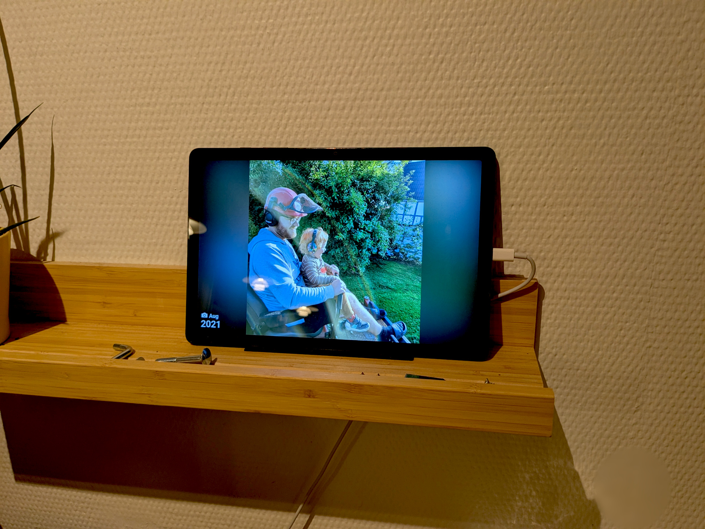

# A digital photo frame

There is no longer a reason not to dust off your old tablet and install a kiosk browser.

That is unless you are not using Nextcloud. But we all know you are, so get going!

Because now you can easily turn your photo albums into neat digital photo frames - with Photo Frames, an app for nextcloud.

Configure all the things:

- When photos change
- Cropping (with _smart fit_)
- Whether or not to show the _photo date_...
- ...and/or a _clock_
- How to pick the next photo (and whether or not to prioritize recent photos)

It is pretty cool if I may say so myself...

_...which I may, because I'm using it all the time!_

Check it out [here](https://apps.nextcloud.com/apps/photo_frames)

And if you want to see how the sausage gets made, do that [here](https://github.com/jeppester/nextcloud-photo-frames/)

I am open for contributions - if they are good! :D
